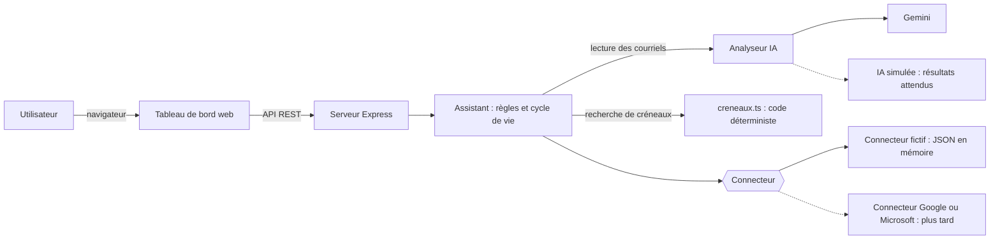
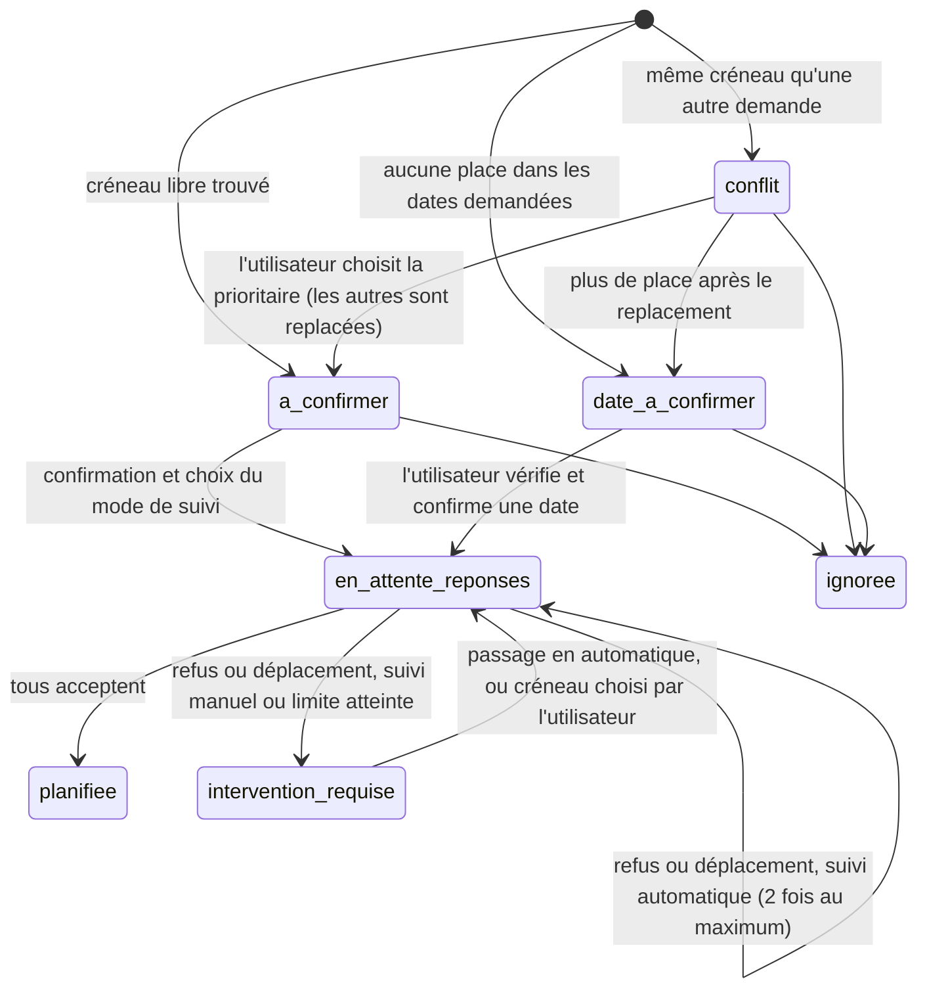

# Architecture de l'assistant

## 1. Comment l'assistant accède aux courriels et aux calendriers

L'assistant doit lire les courriels entrants d'un utilisateur, consulter les calendriers de l'équipe, y ajouter des rendez-vous et envoyer des invitations. Trois façons de le faire ont été comparées.

| Option | Principe | Avantages | Inconvénients |
|---|---|---|---|
| Extension de navigateur | Lit la page Gmail ou Outlook ouverte dans le navigateur | Simple à installer; voit ce que voit l'utilisateur | Ne fonctionne que si l'onglet du courriel est ouvert; dépend du code HTML de la page, qui change sans avertissement; aucune surveillance en arrière-plan; demande un accès large au navigateur |
| Module complémentaire du logiciel de courriel (Gmail ou Outlook) | Panneau affiché à côté du courriel ouvert | Intégré là où l'utilisateur lit ses courriels | Un développement différent par fournisseur (Apps Script pour Gmail, Office.js pour Outlook); s'active quand l'utilisateur ouvre un courriel, pas en arrière-plan; demande quand même un serveur; interface limitée |
| **Application web + API officielles (retenue)** | Le serveur se connecte à la boîte et aux calendriers par les API du fournisseur (Gmail API et Google Agenda API, ou Microsoft Graph), avec l'autorisation OAuth de l'utilisateur | Surveille la boîte même quand le navigateur est fermé; même pile Node.js/TypeScript du début à la fin; un connecteur par fournisseur derrière une même interface; c'est le modèle de la plupart des outils de planification | L'utilisateur ouvre un tableau de bord pour confirmer; une mise en production exigerait la vérification de Google pour l'accès à Gmail (le mode test de Google suffit pour une petite équipe) |

**Choix :** une application web avec un serveur Node.js/TypeScript. Le serveur ne parle aux courriels et aux calendriers qu'à travers une interface `Connecteur` (`src/connecteur.ts`). Pour le cours, la seule implémentation est le **connecteur fictif**, qui travaille sur les fichiers JSON de `donnees/`. Un connecteur Google ou Microsoft pourrait être ajouté plus tard sans modifier l'assistant. Un module complémentaire Gmail ou Outlook pourrait aussi devenir une simple « porte d'entrée » vers le même serveur.

## 2. Vue d'ensemble

Partage des rôles :

- **Gemini** lit le texte : il décide si un courriel demande une réunion, en extrait le sujet, les participants, la durée et les dates, et classe les réponses des participants.
- **La validation** (`src/validation.ts`) contrôle tout ce que retourne le modèle : adresses inconnues retirées, durée ou dates illisibles ignorées, participants obligatoires ajoutés.
- **Le code déterministe** fait le reste : recherche de créneaux, préférences par utilisateur, conflits, envoi des invitations. Ces décisions sont donc vérifiables et testables.

## 3. Cycle de vie d'une réunion

Règles principales :

- **Créneau :** premier moment libre pour tous les participants, par pas de 15 minutes, du lundi au vendredi. Les préférences de chaque participant sont respectées (heure du dîner, hors des heures de bureau) : la plus restrictive l'emporte.
- **Dates :** celles du courriel si elles sont précisées; sinon la plage de recherche de l'utilisateur (14 jours dans les données fictives). Jamais avant la réception du courriel.
- **Durée :** 30 minutes si le courriel ne la précise pas; l'interface doit le signaler (`dureeParDefaut`).
- **Créneaux en double :** une demande dont le créneau chevauche celui d'une autre demande non confirmée, avec un participant commun, forme un groupe. L'utilisateur choisit la réunion prioritaire; elle garde son créneau et les autres sont replacées autour, dans l'ordre de réception.
- **Propositions stables :** un créneau proposé et pas encore confirmé est réservé; il ne bouge pas quand l'utilisateur confirme une autre réunion, sauf s'il devient occupé.
- **Aucune place :** l'assistant ne choisit rien seul; il demande à l'utilisateur de vérifier et de confirmer une date, avec une suggestion prise dans sa plage de recherche.
- **Réponses des participants :** en suivi automatique, un refus ou une demande de déplacement entraîne une replanification (le moment proposé par le participant d'abord, puis les dates de la demande, puis la plage de recherche), deux fois au maximum. En suivi manuel, l'utilisateur choisit : passer en automatique, ou choisir lui-même le créneau (une suggestion est fournie).
- **Après une replanification :** une nouvelle invitation est envoyée et tous les participants doivent accepter de nouveau. Une réponse à une ancienne invitation est ignorée.

## 4. API REST

| Méthode | Route | Rôle |
|---|---|---|
| GET | `/api/sante` | État du serveur, IA et connecteur utilisés |
| GET | `/api/etat` | Utilisateurs, préférences et réunions |
| POST | `/api/courriels/traiter` | Lire les nouveaux courriels de la boîte |
| GET | `/api/reunions/:id` | Détail d'une réunion, avec son historique |
| POST | `/api/reunions/:id/prioritaire` | Choisir la réunion prioritaire d'un groupe en double |
| POST | `/api/reunions/:id/confirmer` | Confirmer : `{ "modeSuivi": "automatique" \| "manuel", "debut"?: "AAAA-MM-JJTHH:MM" }` |
| POST | `/api/reunions/:id/ignorer` | Écarter une demande pas encore confirmée |
| POST | `/api/reunions/:id/mode` | Changer le suivi : `{ "modeSuivi": ... }` |
| POST | `/api/reunions/:id/creneau` | L'utilisateur choisit un nouveau créneau : `{ "debut": ... }` |
| PUT | `/api/utilisateurs/:courriel/preferences` | Modifier la configuration d'un utilisateur |
| GET | `/api/calendriers` | Calendriers de l'équipe |
| GET | `/api/envois` | Courriels envoyés par l'assistant |
| GET | `/api/simulation/reponses` | Réponses fictives de participants disponibles |
| POST | `/api/simulation/reponses/:id` | Déposer une réponse fictive dans la boîte et la traiter |
| POST | `/api/simulation/reinitialiser` | Remettre les données fictives à leur état initial |

Les erreurs sont renvoyées en JSON (`{ "erreur": "..." }`) avec le code 400 (requête invalide), 404 (introuvable) ou 409 (action impossible dans l'état actuel).

## 5. Tableau de bord prévu

Une page web servie par le même serveur (dossier `public/`), en quatre écrans :

1. **À traiter :** demandes à confirmer (avec le choix du mode de suivi), groupes de créneaux en double, dates à confirmer et interventions après un refus.
2. **Réunions :** réunions envoyées, réponses des participants et historique.
3. **Calendrier :** semaine de l'équipe, avec les réunions planifiées par l'assistant.
4. **Configuration et simulation :** préférences de chaque utilisateur, réponses fictives à déposer, réinitialisation.

## 6. Limites connues

- Les réunions sont gardées en mémoire : un redémarrage du serveur remet les données fictives à leur état initial.
- Un refus n'exclut que le créneau refusé. Si un participant refuse parce qu'il est absent toute la journée, l'assistant peut proposer un autre moment le même jour.
- Si le moment proposé par un participant n'a aucune place, le suivi automatique se rabat sur les dates de la demande d'origine, qui peuvent ne pas lui convenir.
- Les préférences modifiées s'appliquent aux propositions suivantes; elles ne déplacent pas les réunions déjà proposées.
